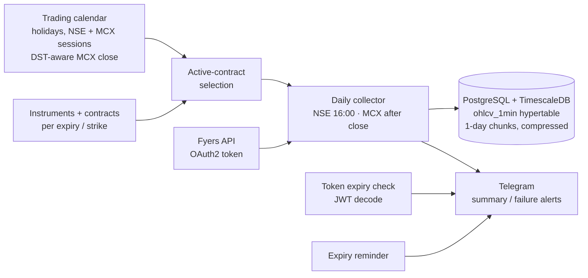

# fno-archive: Self-Hosted F&O Market-Data Warehouse

A TimescaleDB archive of **1-minute OHLCV data for 8,000+ NSE and MCX option contracts**, collected automatically every night, with gap detection, backfill and Telegram alerting. It runs on AWS EC2 alongside live production trading systems, with resource isolation so data jobs never interfere with live trading.

Brokers only keep intraday history for a limited window. This project builds a permanent, queryable archive for backtesting and research.

## Architecture



## Highlights

- **Time-series schema** (`schema.sql`): `instruments` → `contracts` (per expiry/strike/CE-PE) → `ohlcv_1min` TimescaleDB hypertable with 1-day chunks and compression after 30 days
- **Exchange-aware calendar** (`populate_calendar.py`): NSE/BSE and MCX sessions, holidays, and MCX's DST-dependent evening close (23:30 / 23:55)
- **Split scheduling:** separate NSE and MCX cron runs, each after its own market close, with timestamped per-day logs and explicit exit codes
- **Dead-token detection:** broker errors that mean "the session itself is bad" are separated from per-contract data problems. The run stops at once with a clear alert instead of retrying a dead token across 1,000+ contracts
- **Token health check** (`check_token.py`): decodes the access token's JWT payload to read its real expiry, catching a "refresh" that silently didn't land
- **Low-noise alerting** (`telegram_alerts.py`): summary and failure alerts, not one ping per missing contract (that would be 600+ messages a night). A missing summary is itself treated as a signal that cron or the server died
- **Independent expiry reminder:** a separate cron entry, so a collector failure can't suppress it
- **Secrets from environment only** (see `.env.example`)

## Run

```bash
psql -d fno_archive -f schema.sql
python populate_calendar.py
python populate_instruments_contracts.py
cp .env.example .env && python generate_token.py   # one-time OAuth2 login
./run_daily_collector_nse.sh                        # nightly via cron
./run_daily_collector_mcx.sh
```

## Tech

Python · PostgreSQL 17 · TimescaleDB · Fyers API (REST, OAuth2) · cron / bash · AWS EC2 (SSM) · Telegram Bot API

---
Research and data-infrastructure project. Not investment advice.
